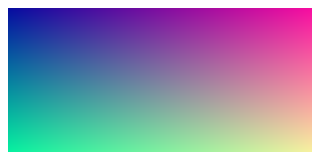

# Образец для проверки

Абзац с **жирным**, *курсивом*, ~~зачёркнутым~~ и `кодом`. Строка достаточно длинная, чтобы перенестись на следующую строку экрана.

## Ссылки

[Раздел «Таблица»](#таблица), [второй файл](second.md#нужный-раздел), [сайт](https://example.com), [запрещённая](file:///etc/hosts).

## Задачи

- [x] сделано
- [ ] не сделано
  - вложенный пункт

1. первый
2. второй

> Цитата
>
> > вложенная

> [!WARNING]
> Предупреждение

## Таблица

| Слева | Справа | По центру |
|:------|-------:|:---------:|
| кириллица | 1 | 日本語 |
| `код` | 20 | **жирный** |
| ☐ ☑ ▌ ▣ | 300 | é ё й |

## Код

```rust
// комментарий
fn main() {
    let text = "строка";
    println!("{text} {}", 42);
}
```

## Картинка




## Формулы

В строке: $E = mc^2$, $\sum_{i=1}^{n} x_i$, $\frac{a+b}{c}$.

$$
A = \begin{pmatrix} 1 & 2 \\ 3 & 4 \end{pmatrix}
$$

Непонятная формула остаётся исходной: $\unknowncommand{x}$.

Сноска[^1].

[^1]: Текст сноски.
